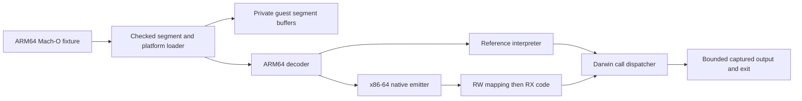

# Sable execution design

## Loader

`macho.rs` validates the thin little-endian header, ARM64 subtype, executable file
type, command lengths, guest ranges, nonoverlapping accessible segments,
permissions, simulator platform and executable entry. Inaccessible `__PAGEZERO`
is reserved conceptually rather than allocating 4 GiB. Accessible segments total
at most 64 MiB; the instruction section is at most 1 MiB. All integer arithmetic
at file/range boundaries is checked. Guest executable storage is immutable.

The strict freestanding path rejects dynamic library dependencies, chained fixups, dyld rebasing or
binding, undefined dynamic symbols, section/dynamic relocations, encryption,
arm64e and unknown required commands. Symbols, signatures, export metadata and
the dylinker path are not executed. The `__text` section defines the instruction
range; entry must lie inside it. Data reads require readable segment permissions.

`Image::parse` remains the strict freestanding path. `Image::link` supports a
restricted eager dynamic path described in [the dynamic-loader design](dynamic-linking.md).
Neither executes Apple's dyld or constructs a complete Darwin process startup stack.

## Execution

`isa.rs` decodes selected 32/64-bit move-wide, add/subtract, shifted logical
operations, logical immediates, conditional compares, ADR/ADRP, B/BL, B.cond,
CBZ/CBNZ, RET, NOP and checked SVC instructions.
Arithmetic flags use ARM's no-borrow carry convention for subtraction. Logical
flag-setting operations set N/Z and clear C/V. Conditions read saved NZCV rather
than relying on host flags that budget and address checks can change.
Register 31 reads SP for add/sub immediate. Non-flag-setting immediate arithmetic
and logical-immediate destinations can write SP; logical sources use ZR. Other
supported register arithmetic uses zero/discard. Flag-setting writes to register
31 discard the result.
W-register writes zero-extend into X-registers.

Scalar memory access supports 1/2/4/8-byte loads/stores, unsigned immediate offsets,
unscaled signed offsets, pre/post-index writeback and UXTW/LSL/SXTW/SXTX register
offsets. Integer pairs support 4/8-byte elements and stack frame addressing.
Constrained-unpredictable overlaps are rejected rather than assigned arbitrary
semantics. Signed loads, SIMD, unprivileged access forms and atomics remain unsupported.

`memory.rs` forks writable image buffers into each run, shares immutable image
bytes through `Arc<Vec<u8>>`, and adds a reserved 1 MiB stack.
The freestanding process starts with aligned SP at the stack top. Images with
initializers use the bounded [startup arguments](initializers.md). Scalar
[TLS storage](tls.md) is fixed before compilation and private to each run.
Loads zero-extend, stores truncate to the access width, and
an access must fit wholly in one region with the required permission. SP-based
accesses check 16-byte alignment. Failed memory operations preserve registers,
base writeback, memory and the remaining instruction count; pair stores validate
the entire range before writing either element. Executable image bytes remain
immutable. There is no dynamic allocation or guest memory-mapping syscall yet.

`engine.rs` provides the reference state transition. A finite instruction budget
stops loops. The reference is intentionally straightforward and unoptimized;
comparison with it is an internal engineering measurement, not a QEMU/Macbox result.

`jit.rs` lowers the supported operations into SysV x86-64 instructions. RDI holds
a pointer to a `repr(C)` CPU record, RSI a host-only region-pointer table. RAX,
RDX, RCX and R8–R11 are scratch registers. Static use counts select two guest
registers to cache in R12/R13; R14 holds the instruction budget and R15 the guest
PC. Entry trampolines save R12–R15 and load cached state. Every exit flushes state
and restores those host registers. Generated code makes no host function calls.
Direct guest branches become patched native relative branches. Indirect calls
and returns validate target range and alignment, then use a host-only immutable
relative-offset table to enter the corresponding guarded block. Invalid targets
exit with preserved guest state. Rust dispatch remains a diagnostic comparison mode.
Straight arithmetic blocks charge their instruction count at entry. If the
remaining budget cannot cover a block, Rust executes one instruction and retries,
preserving exact partial-block state. Every memory operation is its own block so
a fault cannot consume future instructions. Dynamic entry into a block's middle
has its own budget trampoline. Tests compare these states with the interpreter.
SVC saves the next PC and returns to Rust. `Prepared` retains this RX mapping
across runs while each run receives independent writable memory and CPU state.

Single loads/stores check guest address bounds and permissions, then translate
through the host-only buffer-pointer table. The runtime holds exclusive mutable
access to those buffers during native execution. No Rust reference accesses them
while generated code runs; fixed-size buffers and the pointer table stay allocated
through the call and any paired-access fallback. Pairs exit before execution and
use the same checked Rust transition as the interpreter. Fault exits do not write
back the base or decrement the instruction budget.

The host mapping starts RW, receives generated bytes, then becomes RX via
`mprotect`. No mapping is RWX. The owned mapping stays alive through each native
call and is unmapped on drop. The only unsafe code is in this Linux x86-64 backend
for allocation and entry. Guest arithmetic values cannot become native instruction
pointers or unchecked host memory pointers. This limits current attack paths but is not a
security audit or a promise of sandbox isolation.

## Darwin boundary

For Darwin calls the SVC immediate is `0x80`, number in X16, arguments in X0 onward.
The separate `svc #0x5ab1` is a checked Sable-private scalar TLV resolver,
described in [the TLS contract](tls.md); it supplies no Darwin service number.
Current successful calls are deliberately narrow:

| Number | Behavior |
| --- | --- |
| 1 | Exit with X0's low byte |
| 4 | Capture a checked readable guest range for stdout/stderr only |
| 20 | Return deterministic PID 1 for this single-process test environment |
| -3 | Return elapsed host monotonic nanoseconds, experimental timebase 1:1 |

Writes are limited to 1 MiB per call and 4 MiB per output stream. Unsupported
calls, descriptors and invalid buffers terminate with an explicit research error.
Successful write/getpid calls clear Darwin's carry error flag. Errno returns and
other error semantics remain unimplemented; calls do not pretend success for
missing behavior. The timer is not a CPU counter and is excluded from the
deterministic full-state benchmark. There is no Mach message transport yet.

## Evidence and limitations

Tests cover linked fixtures, independent checksum/count expectations, truncation
at every byte, header/command corruption, memory permissions, budget exhaustion,
W-register wrapping, SP/zero-register rules and unsupported calls. Linux tests
also compare 1,000 deterministic generated arithmetic programs between engines,
BL/RET and direct branches, unsupported instructions and out-of-range targets.
Both engines share a decoder and syscall implementation, so their agreement
cannot prove those shared components correct. The linked fixtures also ran
through Apple's iOS 27.2 Simulator, with matching hello output and successful
exits. Broad native Apple/QEMU differential instruction tests remain a required
next step before broader compatibility claims. The newer C and output-checked
arithmetic fixtures also match the Apple Simulator's emitted checksum bytes.

`scripts/oracle.py` uses Unicorn 2.1.4, which is independent of Sable's decoder and
executor. It compares complete general registers, SP/PC, NZCV, instruction counts
and 512 bytes of data plus 4 KiB of stack. Cases cover incoming flag combinations,
32/64-bit arithmetic edges, shifted operands, addressing modes and BL/RET. This
validates the tested scalar subset, not the full ISA, kernel behavior, threading,
memory ordering or platform services. [Raw evidence](../evidence/s1/RESULTS.md).
