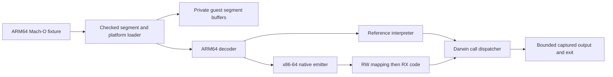

# Sable execution design

## Loader

`macho.rs` validates the thin little-endian header, ARM64 subtype, executable file
type, command lengths, guest ranges, nonoverlapping accessible segments,
permissions, simulator platform and executable entry. Inaccessible `__PAGEZERO`
is reserved conceptually rather than allocating 4 GiB. Accessible segments total
at most 64 MiB; the instruction section is at most 1 MiB. All integer arithmetic
at file/range boundaries is checked. Guest executable storage is immutable.

The loader rejects dynamic library dependencies, chained fixups, dyld rebasing or
binding, undefined dynamic symbols, section/dynamic relocations, encryption,
arm64e and unknown required commands. Symbols, signatures, export metadata and
the dylinker path are not executed. The `__text` section defines the instruction
range; entry must lie inside it. Data reads require readable segment permissions.

This is a loader for a restricted freestanding format, not Apple's dyld
implementation. It does not construct a real Darwin process startup stack.

## Execution

`isa.rs` decodes selected 32/64-bit move-wide, add/subtract, register OR, ADR/ADRP,
B/BL, CBZ/CBNZ, RET, NOP and `svc #0x80` instructions. Flags-setting arithmetic,
shifted-register operands and every unimplemented encoding fail explicitly.
Register 31 is SP for add/sub immediate and zero/discard for the other supported
operations. W-register writes zero-extend into X-registers.

`engine.rs` provides the reference state transition. A finite instruction budget
stops loops. The reference is intentionally straightforward and unoptimized;
comparison with it is an internal engineering measurement, not a QEMU/Macbox result.

`jit.rs` lowers the supported operations into SysV x86-64 instructions. RDI holds
a pointer to a `repr(C)` CPU record. RAX and RDX are scratch registers. Generated
code preserves callee-saved host registers and makes no host function calls.
Direct guest branches become patched native relative branches. Dynamic RET
returns to the dispatcher, which validates the destination before entering code.
Every guest instruction records its PC and checks/decrements the same budget as
the reference. SVC saves the next PC and returns to Rust.

The host mapping starts RW, receives generated bytes, then becomes RX via
`mprotect`. No mapping is RWX. The owned mapping stays alive through each native
call and is unmapped on drop. The only unsafe code is in this Linux x86-64 backend
for allocation and entry. Guest arithmetic values cannot become native instruction
pointers or host memory pointers. This limits current attack paths but is not a
security audit or a promise of sandbox isolation.

## Darwin boundary

The SVC immediate is `0x80`, syscall/trap number is in X16, arguments in X0 onward.
Current successful calls are deliberately narrow:

| Number | Behavior |
| --- | --- |
| 1 | Exit with X0's low byte |
| 4 | Capture a checked readable guest range for stdout/stderr only |
| 20 | Return deterministic PID 1 for this single-process test environment |
| -3 | Return elapsed host monotonic nanoseconds, experimental timebase 1:1 |

Writes are limited to 1 MiB per call and 4 MiB per output stream. Unsupported
calls, descriptors and invalid buffers terminate with an explicit research error.
Darwin errno/carry semantics are not implemented; calls do not pretend success
for missing behavior. The timer is not a CPU counter and is excluded from the
deterministic full-state benchmark. There is no Mach message transport yet.

## Evidence and limitations

Tests cover linked fixtures, independent checksum/count expectations, truncation
at every byte, header/command corruption, memory permissions, budget exhaustion,
W-register wrapping, SP/zero-register rules and unsupported calls. Linux tests
also compare 1,000 deterministic generated arithmetic programs between engines,
BL/RET and direct branches, unsupported instructions and out-of-range targets.
Both engines share a decoder and syscall implementation, so their agreement
cannot prove those shared components correct. The linked fixtures also ran
through Apple's iOS 27.2 Simulator, with matching hello output and successful
exits. Broad native Apple/QEMU differential instruction tests remain a required
next step before broader compatibility claims. [Raw evidence](../evidence/README.md).
